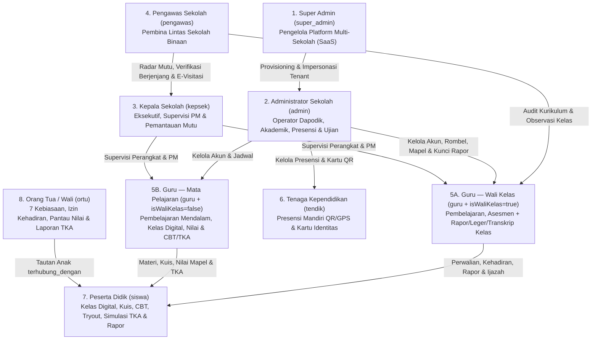

# Panduan Lengkap Peran (Role) & Hak Akses Aktif — SIMANTAP MONSA

Dokumen ini merupakan referensi resmi seluruh **8 peran utama (`users.peran`)** beserta **2 sub-peran fungsional Guru (Wali Kelas vs Guru Mata Pelajaran)** yang aktif pada platform **SIMANTAP MONSA (Laravel 13 Multi-Tenant)**.

> [!IMPORTANT]
> Seluruh definisi peran, pengalihan dasbor, pembatasan *middleware*, dan struktur menu di bawah ini disarikan langsung dari kode sumber aktif: [User.php](file:///e:/Project/simantap/app/Models/User.php), [DashboardRedirectController.php](file:///e:/Project/simantap/app/Http/Controllers/DashboardRedirectController.php), [RoleMiddleware.php](file:///e:/Project/simantap/app/Http/Middleware/RoleMiddleware.php), [routes/web.php](file:///e:/Project/simantap/routes/web.php), dan seluruh *partial sidebar* peran.

---

## 1. Peta Arsitektur Peran & Hierarki Akses

---

## 2. Ringkasan Matriks 8 Peran Utama (`users.peran`)

| No | Kode `peran` | Nama Peran | Rute Dasbor Utama (`DashboardRedirectController`) | Prefix Rute Utama | Lingkup Data (*Tenant Scope*) |
|---:|---|---|---|---|---|
| **1** | `super_admin` | **Super Admin Platform** | `superadmin.dashboard` (`/superadmin/dashboard`) | `/superadmin/*` | **Global Lintas Tenant** (`tenant_id = null`, `withoutGlobalScopes()`) |
| **2** | `admin` | **Administrator / Operator Sekolah** | `admin.dashboard` (`/admin/dashboard`) | `/admin/*` | **1 Sekolah Aktif** (`tenant_id` sekolah, `school.context`) |
| **3** | `kepsek` | **Kepala Sekolah** | `kepsek.dashboard` (`/kepsek/dashboard`) | `/kepsek/*`, `/presensi/pegawai/*` | **1 Sekolah Aktif** (`tenant_id` sekolah, `school.context`) |
| **4** | `pengawas` | **Pengawas Sekolah** | `pengawas.dashboard` (`/pengawas/dashboard`) | `/pengawas/*` | **Multi-Sekolah Binaan** (`tenant_id` utama + array `terhubung_dengan` ID tenant binaan) |
| **5** | `guru` | **Guru (Wali Kelas / Guru Mapel)** | `guru.dashboard` (`/guru/dashboard`) | `/guru/*`, `/cbt/*`, `/tryout/*`, `/tka/*`, `/presensi/pegawai/*` | **1 Sekolah Aktif + Kelas/Mapel Ampu** (`tenant_id` + isolasi kelas/rombel/jadwal) |
| **6** | `tendik` | **Tenaga Kependidikan (Staf/TU)** | `presensi.pegawai.index` (`/presensi/pegawai`) | `/presensi/pegawai/*` | **Diri Sendiri di Sekolah Aktif** (`user_id = auth()->id()`) |
| **7** | `siswa` | **Peserta Didik (Siswa)** | `siswa.dashboard` (`/siswa/dashboard`) | `/siswa/*`, `/cbt/student/*`, `/tryout/student/*` | **Diri Sendiri & Kelasnya** (`Siswa` tertaut via `terhubung_dengan` / `nis` / `nisn`) |
| **8** | `ortu` | **Orang Tua / Wali Siswa** | `ortu.dashboard` (`/ortu/dashboard`) | `/ortu/*`, `/tka/parent/*` | **Anak Kandung/Perwalian** (array `users.terhubung_dengan` berisi `siswa.id` di sekolah yang sama) |

---

## 3. Rincian Lengkap Per Peran

### 3.1. Super Admin (`super_admin`)
- **Tujuan**: Mengelola infrastruktur multi-sekolah (SaaS), pendaftaran sekolah (*tenant*), kuota/paket langganan, serta pemulihan akses administrator sekolah.
- **Middleware**: `['auth', 'role:super_admin', 'force.password.change', 'menu.telemetry']`
- **Daftar Fitur & Kewenangan** ([routes/web.php](file:///e:/Project/simantap/routes/web.php#L200-L219)):
  1. **Dasbor SaaS (`superadmin.dashboard`)**: Statistik total sekolah terdaftar, sekolah aktif/kedaluwarsa, distribusi paket langganan, dan total pengguna lintas sekolah.
  2. **Manajemen Sekolah / Tenant (`superadmin.tenants.*`)**:
     - Mendaftarkan sekolah baru (`POST /superadmin/tenants`) sekaligus membuat akun `admin` sekolah dan baris awal `sekolah_settings`.
     - Mengubah profil, kuota, tanggal kedaluwarsa langganan, atau mengaktifkan/menonaktifkan sekolah (`tenants.toggle`).
     - Menghapus sekolah kosong atau membersihkan tenant kedaluwarsa secara massal (`tenants.bulk-destroy-expired`).
  3. **Impersonasi Admin Sekolah (`superadmin.tenants.impersonate` & `superadmin.impersonate.leave`)**:
     - Masuk sementara sebagai Administrator aktif suatu sekolah untuk bantuan teknis (dengan regenerasi sesi & pencatatan `impersonator_id`).
  4. **Reset Sandi Admin & Manajemen User Global (`superadmin.tenants.reset-admin-password`, `superadmin.users.*`)**:
     - Mereset kata sandi akun admin sekolah dan mengelola akun yatim (`tenant_id = null`).

---

### 3.2. Administrator / Operator Sekolah (`admin`)
- **Tujuan**: Mengelola seluruh operasional akademik, integrasi Dapodik, presensi mesin/QR, rapor, transkrip ijazah, serta manajemen ujian (CBT, Tryout, TKA) di dalam satu sekolah.
- **Middleware**: `['auth', 'role:admin', 'force.password.change', 'school.context', 'menu.telemetry']`
- **Struktur Navigasi (4 Tab Utama di [admin/partials/sidebar.blade.php](file:///e:/Project/simantap/resources/views/admin/partials/sidebar.blade.php))**:
  1. **Tab Setup & Operasional (`setup`)**:
     - **Dasbor Admin (`admin.dashboard`)**: Ringkasan statistik siswa, guru, rombel, status sinkronisasi Dapodik, dan aktivitas sekolah.
     - **Integrasi & Impor Data**: Sinkronisasi Dapodik (`admin.dapodik.*` — Bridge Desktop, WebService lokal, maupun Impor Excel/CSV manual) dan kirim nilai ke Dapodik (`admin.dapodik.push.*`).
     - **Data Sekolah & Periode**: Profil Sekolah (`admin.sekolah.*`), Semester & Tahun Ajaran (`admin.semester.*`), Validasi Kelengkapan Data (`admin.validasi-data.*`).
     - **Pendidik & Peserta Didik**: Data Guru & Gelar PTK (`admin.referensi.guru`), Data Siswa (`admin.users.siswa`), Unggah Foto Siswa Privat/ZIP (`admin.referensi.foto-siswa`).
     - **Kelas & Pembelajaran**: Rombel & Peta Kelas (`admin.peta-kelas.*`, termasuk **Kunci Input Rapor** per kelas), Mata Pelajaran (`admin.mapel.*`), Alokasi Waktu Kurikulum (`admin.pm.alokasi.*`), Kalender & Hari Libur (`admin.pm.kalender.*`), Jadwal Pembelajaran, Ekstrakurikuler, Kelompok Mapel, Teknik Penilaian.
     - **Akun & Kode Akses**: Manajemen Akun semua peran di sekolahnya (`admin.users.*`), Reset Sandi Instan/Massal, **Impersonasi Guru** (`admin.users.impersonate-guru`), serta Cetak Kode Akses Login (`admin.kode-akses.*`).
     - **Presensi Pegawai & Siswa**: Dashboard Presensi Mesin ZKTeco/Attendance (`admin.presensi.dashboard.mesin`), Riwayat Sinkron Bridge (`admin.presensi.mesin.sinkron`), Presensi Pegawai & Geofence Lokasi GPS (`admin.presensi.index`), Laporan Presensi (`admin.presensi.laporan`), Import/Tarik Presensi Mesin Asinkron (`admin.presensi.mesin.index`), Penerbitan & Cetak Kartu QR Siswa/Pegawai (`admin.presensi.kartu.*`).
     - **Kokurikuler**: Tema, Kegiatan, dan Kelompok Anggota Kokurikuler (`admin.kokurikuler.*`).
     - **Sistem & Keamanan**: Pengaturan Modul & Tampilan (`admin.modul.*`), Integrasi Google Sheet (`admin.sheet.*`), Kunci API Bridge SHA-256 (`admin.api-keys.*`), serta (khusus mode sekolah tunggal) Backup & Restore Streaming JSON (`admin.backup.*`) dan Log Aktivitas (`admin.log.*`).
  2. **Tab e-Rapor & Cetak (`erapor`)**:
     - Status Penilaian per Guru & Statistik Nilai Rapor (`admin.penilaian.*`).
     - Perkembangan & Grafik Nilai Rapor (`admin.perkembangan.*`).
     - Pengaturan Cetak & Rapor: Mapping Rapor, Tanggal Rapor, Logo & TTD, Cek Alignment e-Rapor, Bobot & Ketuntasan (KKM), Pengaturan Naik Kelas, Penilaian P5BK.
     - **Transkrip Ijazah (`admin.transkrip.*`)**: Setting Transkrip, Nomor Ijazah (manual & CSV), Input/Import Nilai Transkrip, dan Cetak Transkrip Nilai.
     - **Cetak Nilai (`admin.cetak.*`)**: Kelengkapan Nilai, Leger Rapor, Pelengkap Rapor, Cetak Nilai Rapor Akademik, Pengaturan & Modifikasi Tampilan Rapor.
  3. **Tab CBT & Tryout (`cbt`)**:
     - Statistik Ujian (`admin.tryout.statistics`), Bank Soal CBT (`admin.cbt.banks.*`), Sesi Ujian CBT & Analisis Butir Soal (`admin.cbt.sessions.*`), Paket/Sesi/Hasil Tryout Sekolah (`admin.tryout.*`).
  4. **Tab TKA (`tka`)**:
     - Pemantauan & Pengaturan Kesiapan TKA (`admin.tka-kesiapan.*`), Dashboard TKA (`admin.tka.dashboard`), Analisis Kognitif Siswa (`admin.tka.kognitif.*`), Laporan Kelas & Heatmap (`admin.tka.laporan-kelas.*`), Dimensi & Kisi-kisi TKA (`admin.tka.dimensions.*`), Data Penilaian Peserta (`admin.tka.assessments.*`), Early Warning Kesiapan (`admin.tka.warnings.*`).

---

### 3.3. Kepala Sekolah (`kepsek`)
- **Tujuan**: Memantau mutu akademik sekolah secara eksekutif, melakukan supervisi berjenjang terhadap Perangkat Ajar dan 9 dokumen Pembelajaran Mendalam (PM) guru, serta memantau kehadiran dan kesiapan TKA.
- **Middleware**: `['auth', 'role:kepsek', 'force.password.change', 'school.context', 'menu.telemetry']`
- **Daftar Menu & Kewenangan** ([kepsek/partials/sidebar.blade.php](file:///e:/Project/simantap/resources/views/kepsek/partials/sidebar.blade.php)):
  1. **Dashboard Eksekutif (`kepsek.dashboard`)**: Agregasi SQL real-time rata-rata nilai sekolah, distribusi predikat A/B/C/D, persentase kehadiran siswa & pegawai hari ini, partisipasi orang tua (7 Kebiasaan), ringkasan CBT, dan kesiapan TKA per kelas.
  2. **Rekap Sekolah (`kepsek.rekap.*`)**: Rekap kinerja setiap guru beserta rincian aktivitas mengajar.
  3. **Presensi Saya (`presensi.pegawai.*`)**: Presensi mandiri masuk/pulang (QR/GPS) dan kartu identitas QR Kepala Sekolah.
  4. **Pemetaan (`kepsek.peta-kelas.*`, `kepsek.hasil-belajar.*`)**: Pemetaan nilai dan hasil belajar siswa per kelas/guru.
  5. **Supervisi Pembelajaran Mendalam (`kepsek.supervisi-pm.*`) & Tanda Tangan (`kepsek.ttd.*`)**:
     - Memeriksa kelengkapan 9 dokumen Pembelajaran Mendalam tiap guru (Alokasi Waktu, CP, TP, ATP, KKTP, Prota, Prosem, Modul Ajar/RPM, Jurnal/Kokurikuler).
     - Memberikan status supervisi (`menunggu`, `direview`, `disetujui`, `revisi`) beserta catatan pembinaan. Saat status **`disetujui`**, dokumen perangkat guru otomatis **terkunci dari pengeditan** dan dibubuhi tanda tangan digital Kepala Sekolah pada cetakan PDF.
     - Mencetak Rekap Supervisi PM dalam format PDF (`kepsek.supervisi-pm.rekap-pdf`).
  6. **Supervisi Perangkat Ajar (`kepsek.perangkat.*`)**: Meninjau dan memberi catatan/persetujuan atas unggahan RPP/Modul Ajar/Silabus guru.
  7. **Pemantauan TKA & Aktivitas (`kepsek.tka-kesiapan.*`, `kepsek.tka-laporan.*`, `kepsek.pantau.*`, `kepsek.kebiasaan.*`, `kepsek.aktivitas.*`)**: Heatmap kesenjangan TKA per kelas (beserta unduh CSV), rekap 7 Kebiasaan, dan log aktivitas guru.

---

### 3.4. Pengawas Sekolah (`pengawas`)
- **Tujuan**: Melakukan kepengawasan akademik dan manajerial lintas sekolah binaan, verifikasi berjenjang di atas Kepala Sekolah, observasi kelas (E-Visitasi), serta audit keselarasan kurikulum hingga e-Rapor.
- **Middleware**: `['auth', 'role:pengawas', 'force.password.change', 'school.context', 'menu.telemetry']`
- **Dukungan Multi-Sekolah Binaan**: Seorang Pengawas dapat membina 1 sekolah (`users.tenant_id`) maupun banyak sekolah sekaligus (daftar ID tenant tambahan pada `users.terhubung_dengan`) dan berpindah konteks sekolah binaan secara instan melalui `POST /pengawas/ganti-sekolah` (`pengawas.ganti-sekolah`).
- **Daftar Menu & Kewenangan** ([pengawas/partials/sidebar.blade.php](file:///e:/Project/simantap/resources/views/pengawas/partials/sidebar.blade.php)):
  1. **Radar Mutu Sekolah (`pengawas.dashboard`)**: Indeks komposit mutu satuan pendidikan (kelengkapan perangkat PM, persentase supervisi Kepsek, capaian e-Rapor, kesiapan TKA, dan kehadiran).
  2. **Verifikasi Perangkat PM Berjenjang (`pengawas.supervisi.*`)**:
     - Menginspeksi secara *read-only* 9 dokumen Pembelajaran Mendalam guru yang telah disupervisi Kepala Sekolah.
     - Menyimpan status verifikasi pengawas (`menunggu`, `terverifikasi`, `pembinaan`), catatan pengawas, dan Rekomendasi Tindak Lanjut (RTL).
  3. **E-Visitasi & Observasi Kelas (`pengawas.visitasi.*`)**:
     - Mencatat berita acara visitasi (`supervisi_akademik`, `supervisi_manajerial`, `pendampingan_kurikulum`, `pemantauan_tka_literasi`) dengan 6 rubrik Pembelajaran Mendalam (*Berkesadaran/Mindful, Bermakna/Meaningful, Menggembirakan/Joyful, Memahami, Mengaplikasi, Merefleksi* skala 1–4).
     - Mencetak Berita Acara Visitasi PDF (`pengawas.visitasi.pdf`).
  4. **Audit Kurikulum & e-Rapor (`pengawas.audit.index`)**: Memeriksa keselarasan berantai CP → TP → ATP → KKTP → Modul Ajar → Nilai e-Rapor dan peta hasil belajar kelas 1–6.
  5. **Tanda Tangan Digital & Laporan Semester PDF (`pengawas.ttd.*`, `pengawas.laporan.pdf`)**: Mengelola tanda tangan digital Pengawas (unggah gambar atau kanvas) dan mencetak **Laporan Kepengawasan Semester PDF** 1-klik untuk Dinas Pendidikan / Korwas.

---

### 3.5. Guru (`guru`) — Wali Kelas & Guru Mata Pelajaran
- **Tujuan**: Melaksanakan perencanaan Pembelajaran Mendalam, mengelola Kelas Digital (E-Learning), melaksanakan asesmen (Kuis, CBT, Tryout, TKA, e-Rapor), serta mencatat kehadiran dan perkembangan karakter siswa.
- **Middleware**: `['auth', 'role:guru', 'force.password.change', 'school.context', 'menu.telemetry']`
- **Pemisahan Sub-Peran Otomatis (`User::isWaliKelas()`)**:
  - Sistem menentukan apakah seorang Guru adalah **Wali Kelas** melalui metode `User::isWaliKelas()` ([User.php](file:///e:/Project/simantap/app/Models/User.php#L175-L202)) dengan urutan prioritas:
    1. Kolom override eksplisit `users.is_wali_kelas` (`true` atau `false`) yang diatur Admin.
    2. Relasi `rombel.guru_id` pada sekolah aktif (bila `is_wali_kelas === null`).
    3. Fallback siswa aktif dengan `siswa.guru_id = user.id` yang belum memiliki `rombel_id`.

#### A. Fitur untuk Seluruh Guru (Guru Kelas & Guru Mapel)
1. **Pembelajaran & Kelas Digital**:
   - **Kelas Digital (`guru.kelas-digital.*`)**: Ruang kelas daring, modul pertemuan, materi pembelajaran, penugasan siswa, dan penilaian pengumpulan tugas.
   - **Pembelajaran Mendalam (`guru.pm.*` & `guru.perangkat.*`)**:
     - Alokasi Waktu, Capaian Pembelajaran (CP), Tujuan Pembelajaran (TP), Alur Tujuan Pembelajaran (ATP), Katalog Buku Paket (SIBI), KKTP (tersinkron ke KKM), Kalender & Hari Libur, Program Tahunan (Prota), Program Semester (Prosem), Modul Ajar/RPM, Jurnal Mengajar, Generator Modul & Jurnal Sekaligus (berbantuan AI Gemini opsional), Kokurikuler, dan Tanda Tangan Digital Guru (termasuk ekspor PDF untuk seluruh dokumen).
     - *Catatan Keamanan*: Apabila supervisi semester tersebut sudah **Disetujui Kepala Sekolah**, seluruh endpoint mutasi dokumen PM terkunci otomatis agar integritas dokumen terjaga.
   - **TP e-Rapor (`guru.tp.*`)**, **Materi Ajar (`guru.materi.*`)**, dan **8 Dimensi Profil Lulusan (`guru.dimensi.*`)**.
2. **Asesmen & Nilai**:
   - Input Nilai Cepat (`guru.input-nilai.*`), Input & Impor Excel Nilai e-Rapor (`guru.nilai-erapor.*` — menghormati kunci rapor Admin per kelas), Input Projek P5 (`guru.p5.*`), Cek Penilaian & Deskripsi (`guru.cek-penilaian.*`), Kuis & Soal (`guru.kuis.*`), Daftar Nilai (`guru.nilai.*`), dan Analisis Belajar (`guru.analisis.*`).
3. **CBT, Tryout & TKA**:
   - Bank Soal & Sesi Ujian CBT (`cbt.*`, termasuk pantauan anti-cheat langsung), Paket & Sesi Tryout (`tryout.*`), serta Pemantauan Kesiapan TKA, Rekap Kognitif & Rekomendasi, Integrasi TKA ke e-Rapor, Heatmap Kelas TKA, Dimensi & Penilaian Diagnostik TKA (`guru.tka.*`, `tka.*`).
4. **Pemantauan, Pelaporan & Pengaturan**:
   - Presensi Saya (`presensi.pegawai.*`), Kehadiran Siswa & Verifikasi Izin Orang Tua (`guru.kehadiran.*` — dengan scan QR siswa), Catatan Siswa (`guru.catatan.*`), Pantauan 7 Kebiasaan (`guru.kebiasaan.*`), Data Siswa & Pungut/Klaim Siswa Rombel (`guru.siswa.*`), Generate e-Rapor (`guru.erapor.*`), Integrasi Google Sheet (`guru.integrasi.*`), dan Pengaturan Guru (`guru.pengaturan.*`).

#### B. Fitur Eksklusif Sub-Peran Wali Kelas (`MENU WALI KELAS` — `guru.walas.*`)
Hanya tampil di sidebar dan hanya mengizinkan akses untuk siswa dalam kelas perwaliannya ([WaliKelasController.php](file:///e:/Project/simantap/app/Http/Controllers/Guru/WaliKelasController.php)):
1. **Input Nilai Ekstrakurikuler (`guru.walas.ekskul`)** untuk siswa di kelas perwaliannya.
2. **Input Keputusan Kenaikan Kelas / Kelulusan (`guru.walas.naik-kelas`)**.
3. **Status & Statistik Penilaian Kelas (`guru.walas.status-penilaian`)** lintas mata pelajaran di kelasnya.
4. **Leger Kelas & Cetak Rapor P5 (`guru.walas.leger`, `guru.walas.rapor-p5`)**.
5. **Transkrip Ijazah Kelas Perwalian (`guru.walas.transkrip.*`)**: Input nomor ijazah, nilai transkrip, dan cetak transkrip siswa kelas perwaliannya.

---

### 3.6. Tenaga Kependidikan (`tendik`)
- **Tujuan**: Akun khusus staf tata usaha, pustakawan, laboran, dan tenaga kependidikan non-guru untuk keperluan kehadiran pegawai.
- **Middleware**: `['auth', 'role:guru,kepsek,tendik', 'force.password.change', 'school.context', 'menu.telemetry']`
- **Daftar Menu & Kewenangan** ([pegawai/partials/sidebar.blade.php](file:///e:/Project/simantap/resources/views/pegawai/partials/sidebar.blade.php)):
  1. **Presensi Saya (`presensi.pegawai.index`)**: Melihat riwayat kehadiran pribadi (baik dari mesin fingerprint ZKTeco maupun scan mandiri), serta melakukan presensi masuk/pulang mandiri berbasis QR & validasi radius GPS lokasi sekolah.
  2. **Kartu Identitas Saya (`presensi.pegawai.kartu`)**: Menampilkan dan mencetak kartu identitas pegawai ber-QR code terenkripsi/terversi.
  3. **Ganti Kata Sandi (`force-password-change.show`)**: Pembaruan kata sandi akun secara mandiri.

---

### 3.7. Peserta Didik / Siswa (`siswa`)
- **Tujuan**: Mengakses materi & tugas Kelas Digital, mengerjakan kuis harian, mengikuti Ujian CBT, Tryout, dan Simulasi Adaptif TKA, serta melihat nilai dan mengunduh rapor.
- **Middleware**: `['auth', 'role:siswa', 'force.password.change', 'school.context', 'menu.telemetry']`
- **Resolusi Identitas Siswa**: Akun `User` (`peran = 'siswa'`) dipetakan ke baris `Siswa` aktif di sekolah yang sama melalui `users.terhubung_dengan`, kecocokan `nis == nama_pengguna`, pola `siswa<NIS>`, atau `nisn`.
- **Daftar Menu & Kewenangan** ([siswa/partials/sidebar.blade.php](file:///e:/Project/simantap/resources/views/siswa/partials/sidebar.blade.php)):
  1. **Beranda (`siswa.dashboard`)**: Ringkasan jadwal, pengumuman, tugas aktif, ujian CBT yang sedang berlangsung, dan ringkasan kehadiran/nilai.
  2. **Kartu Pelajarku (`siswa.kartu.cetak`)**: Kartu pelajar digital dengan QR code untuk presensi sekolah/mapel.
  3. **Kelas Digital (`siswa.kelas-digital.*`)**: Mengikuti pertemuan kelas digital, mengunduh materi, dan mengumpulkan tugas.
  4. **Materi (`siswa.materi.*`) & Kuis (`siswa.kuis.*`)**: Membaca materi ajar kelasnya dan mengerjakan kuis interaktif berbatas waktu.
  5. **Nilaiku (`siswa.nilai.*`), Rekap Capaian Rapor (`siswa.rapor.capaian`), & Download Rapor (`siswa.rapor.unduh`)**: Melihat rincian nilai dan mencetak rapor akademik maupun rapor P5.
  6. **Profil Saya (`siswa.profil.*`)**: Memperbarui biodata pelengkap dan foto profil siswa (disimpan di disk privat terautentikasi).
  7. **Ujian & Asesmen TKA**:
     - **Kesiapan Belajarku (`siswa.tka-kesiapan.*`)**: Pemetaan kesiapan belajar TKA pribadi.
     - **Ujian CBT (`cbt.student.*`)**: Mengerjakan sesi ujian CBT aktif dengan *autosave* jawaban, penguncian *submit*, dan sensor integritas (*anti-cheat*).
     - **Tryout Sekolah (`tryout.student.*`)**: Mengerjakan paket tryout multi-mapel dan melihat pembahasan/analisis kelemahan pasca-ujian.
     - **Simulasi TKA Pusmendik & Adaptif (`siswa.tka-simulasi.*`)**: Latihan simulasi TKA mandiri dan simulasi adaptif (kesulitan soal menyesuaikan jawaban secara dinamis) beserta profil kognitif & rekomendasi belajar.

---

### 3.8. Orang Tua / Wali Siswa (`ortu`)
- **Tujuan**: Melaporkan pembiasaan karakter anak di rumah (*7 Kebiasaan Anak Indonesia Hebat*), mengajukan izin ketidakhadiran anak, serta memantau nilai, kehadiran, catatan guru, rapor, dan kesiapan TKA anak.
- **Middleware**: `['auth', 'role:ortu', 'force.password.change', 'school.context', 'menu.telemetry']`
- **Isolasi Data Anak**: Akun Orang Tua hanya dapat mengakses data siswa yang ID-nya terdaftar di dalam kolom JSON `users.terhubung_dengan` dan berada pada `tenant_id` sekolah yang sama. Bila terhubung ke lebih dari satu anak (kakak-adik), orang tua dapat memilih anak aktif melalui parameter/pemilih anak.
- **Daftar Menu & Kewenangan** ([ortu/partials/sidebar.blade.php](file:///e:/Project/simantap/resources/views/ortu/partials/sidebar.blade.php)):
  1. **Ringkasan (`ortu.dashboard`)**: Ikhtisar perkembangan akademik, kehadiran, dan status pengisian 7 Kebiasaan anak.
  2. **Kemitraan — 7 Kebiasaan (`ortu.kebiasaan.*`, `ortu.rekap.*`)**: Mengisi laporan harian *7 Kebiasaan Anak Indonesia Hebat* (Bangun Pagi, Beribadah, Berolahraga, Makan Sehat, Gemar Belajar, Bermasyarakat, Tidur Cepat) dan melihat rekap bulanan.
  3. **Pemantauan Anak**:
     - **Perkembangan Nilai (`ortu.nilai.index`)**: Riwayat nilai tugas, ulangan harian, PTS, PAS, dan kuis anak.
     - **Kehadiran Anak & Pengajuan Izin (`ortu.kehadiran.*`)**: Melihat rekap H/S/I/A anak dan mengajukan permohonan izin/sakit daring untuk diverifikasi oleh Wali Kelas.
     - **Catatan Guru (`ortu.catatan.index`)**: Membaca catatan apresiasi, perhatian, dan perkembangan dari guru.
     - **Laporan / Rapor (`ortu.laporan.index`)**: Melihat laporan hasil belajar semester anak.
     - **Kesiapan Belajar TKA (`ortu.tka-kesiapan.*`), Simulasi & Kognitif TKA (`ortu.tka-riwayat.*`), & Laporan TKA (`tka.parent.*`)**: Memantau riwayat simulasi adaptif anak, zona kemampuan kognitif, rekomendasi pendampingan di rumah, serta menandai laporan TKA telah dibaca orang tua.

---

## 4. Mekanisme Keamanan, Sakelar Fitur, & Siklus Hidup Akun Lintas Peran

| Mekanisme | Penjelasan Teknis |
|---|---|
| **Wajib Ganti Sandi Awal (`force.password.change`)** | Akun baru atau akun yang baru di-reset sandinya memiliki `force_password_change = true`. Middleware [ForcePasswordChange.php](file:///e:/Project/simantap/app/Http/Middleware/ForcePasswordChange.php) menahan pengguna di halaman `/force-password-change` sebelum dapat mengakses fitur apa pun (kecuali sesi *impersonate*). |
| **Isolasi Multi-Sekolah (`IdentifyTenant` + `school.context`)** | Setiap permintaan mengidentifikasi sekolah dari subdomain/header/sesi (`IdentifyTenant`), dan middleware [EnsureSchoolContext.php](file:///e:/Project/simantap/app/Http/Middleware/EnsureSchoolContext.php) menolak (`403`) akun nonaktif (`aktif = false`), akun terarsip (`archived_at != null`), akun milik sekolah yang dinonaktifkan, atau akun tanpa konteks sekolah saat mode multi-sekolah aktif. |
| **Sakelar Modul Asesmen (`module.asesmen` & `cbt.enabled`)** | Grup rute CBT, Tryout, dan TKA dikendalikan oleh pengaturan modul sekolah (`modulAsesmenAktif()`, `kesiapanTkaAktif()`, serta `config('simantap.cbt_enabled')`). Bila dinonaktifkan, menu disembunyikan dari sidebar dan rute menjawab `404`. |
| **Impersonasi Terkendali & Teraudit** | Terdapat 2 jalur impersonasi satu arah yang meregenerasi ID sesi dan mencatat *audit log*: (1) `super_admin` → `admin` sekolah (`superadmin.tenants.impersonate`), dan (2) `admin` → `guru` di sekolah yang sama (`admin.users.impersonate-guru`). |
